
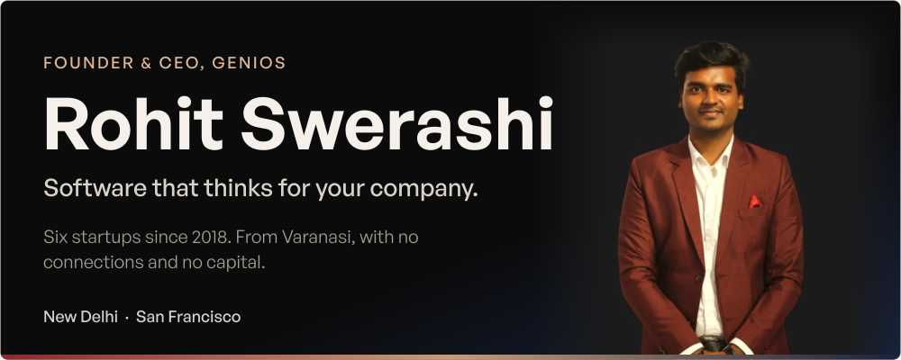

**Founder & CEO of [GeniOS](https://thegenios.com), software that thinks for your company.**

- **Now:** Building GeniOS. $250k ARR, 30+ enterprises piloting.
- **Experience:** 8+ years in company building, product and AI. 6 startups, teams of 50+.
- **Achieved:** $330k revenue and ARR. 10,000+ students mentored. Top 1% on Topmate.
- **Recognised:** Stanford ASES, Harvard HPAIR, Shark Tank India audition finalist (S2, S4), Top 60 Startups Delhi NCR.
- **Backed by:** Founders, Inc. and NSRCEL IIM Bangalore.

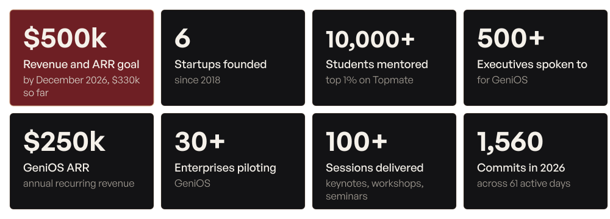

## What I'm building

GeniOS reads a company's tools, decides what matters today, gives it one owner and one date, and closes it only when the proof shows it happened. A human approves everything that goes out.

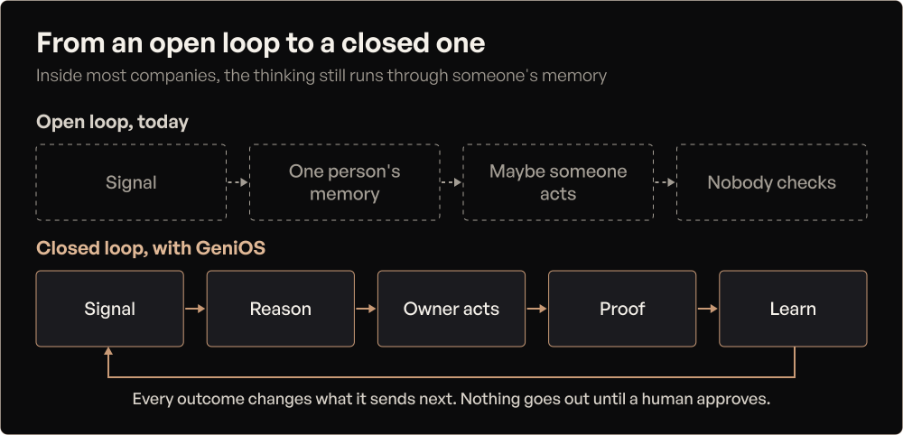

| Support | Who |
|---|---|
| **Backed by** | Founders, Inc. and NSRCEL IIM Bangalore |
| **Incubated at** | IIIT Delhi Innovation & Incubation |
| **Supported by** | NVIDIA Inception, Microsoft for Startups Founders Hub, Composio (YC) startup partner |
| **Advised by** | Senior engineers from Google, IBM and Adobe |
| **Read more** | [The Autonomous Company manifesto](https://thegenios.com/manifesto/) |

## The road since 2018

## Revenue and ARR

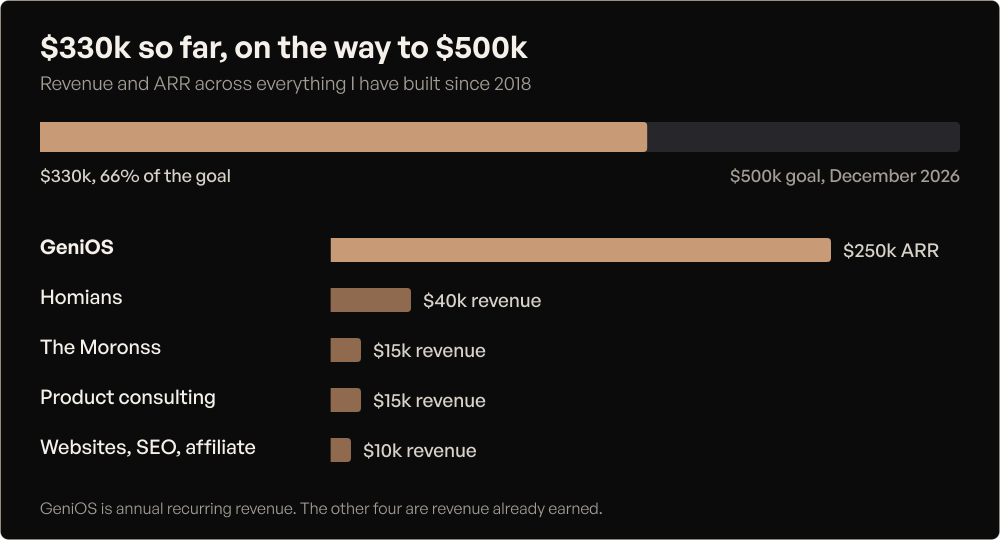

See the numbers as a table

| Source | Amount | Type |
|---|---:|---|
| GeniOS | $250k | ARR |
| Homians | $40k | Revenue |
| The Moronss | $15k | Revenue |
| Product consulting | $15k | Revenue |
| Websites, SEO, affiliate | $10k | Revenue |
| **Total so far** | **$330k** | |
| Goal, December 2026 | $500k | |

## What I've built

<a href="https://thegenios.com">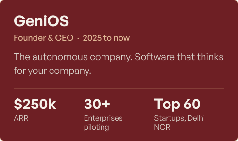</a>
<a href="https://hustlersfellowship.com">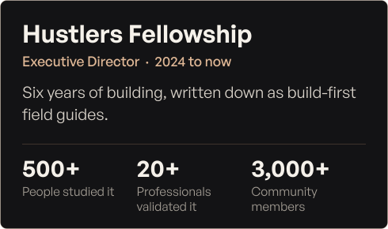</a>
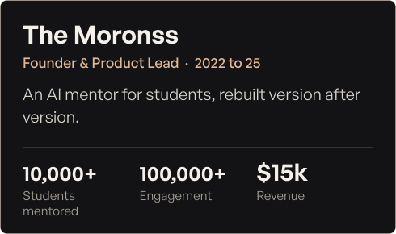
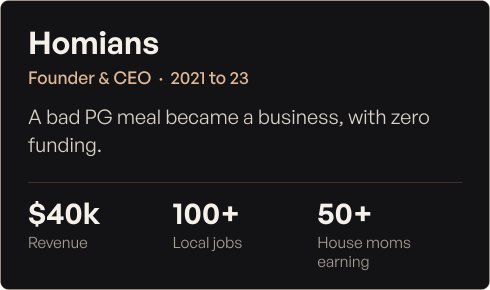
<a href="https://github.com/therohitji/mr-elite-orchestrator">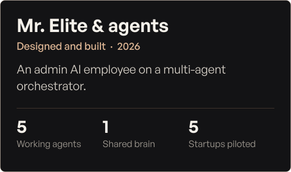</a>
<a href="https://www.linkedin.com/posts/aakritiaggarwal13_resumebuilder-latexresume-webdev-activity-7357028589369769986-lH2B">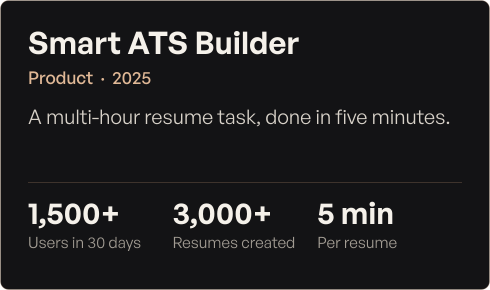</a>

Public code you can read today

| Repository | What it is |
|---|---|
| [thehustlersfellowship](https://github.com/therohitji/thehustlersfellowship) | Hustlers Fellowship: build-first AI courses, live at [hustlersfellowship.com](https://hustlersfellowship.com) |
| [build-live-products](https://github.com/therohitji/build-live-products) | From a raw problem to a live product with real users: 16 chapters, 63 lessons, 10 real teardowns |
| [ai-pm-2026](https://github.com/therohitji/ai-pm-2026) | AI Product Management: 15 chapters, 45 lessons, 10 real teardowns |
| [mr-elite-orchestrator](https://github.com/therohitji/mr-elite-orchestrator) | The multi-agent orchestrator: five agents on one shared brain |
| [happy-openclaw](https://github.com/therohitji/happy-openclaw) | Mr. Happy, a zero-cost AI chief of staff on OpenClaw, Groq, Telegram and React |

## How I work

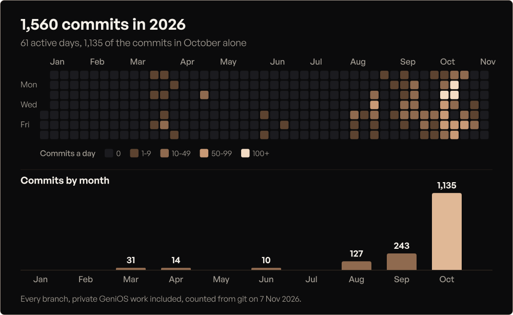

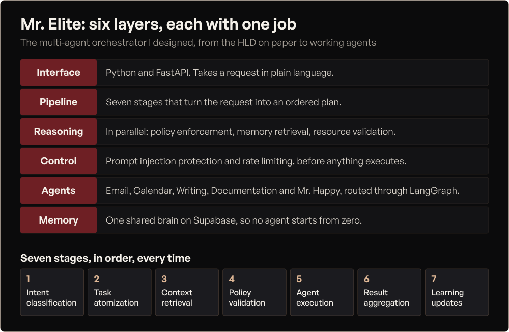

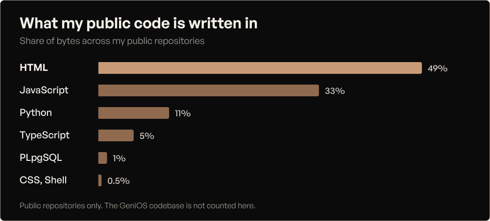

| Area | What I bring |
|---|---|
| **AI and systems** | Multi-agent orchestration, RAG datasets, AI automation, system design, high-level design |
| **Built with** | Claude, OpenAI, Grok, Hermes, OpenClaw, Composio, Python, FastAPI, LangGraph, Gemini, Supabase |
| **Product** | Product analytics, product design, prototyping, A/B testing, SQL, roadmapping, OKRs |
| **Leadership** | Led teams of 50+, trained 60+ interns, agile and scrum, resource planning, cross-functional delivery |
| **Go to market** | Sold door to door and on cold calls, ran my own sales calls, pricing and unit economics |

## People and rooms

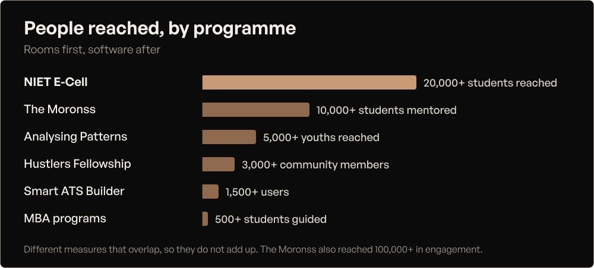

Mentees at BlackRock, AMD, Zscaler, PayPal, Google, EY and Cvent. 100+ sessions, including IIT Bombay (2026) and Thoughtworks (2025).

## Recognition

| Where | What |
|---|---|
| **Stanford ASES** | Delegate, March 2026 |
| **Harvard HPAIR** | Delegate three times: 2025, 2025 Tokyo and 2026 |
| **Shark Tank India** | Audition finalist in Season 2 with Homians, top 1,500 of 80,000, and in Season 4 with The Moronss |
| **Horses Stable, Season 5** | Finalist on national TV, top 50 of 20,000+ |
| **Delhi Startup Yuva Festival** | Top 60 Startups, Delhi NCR, with GeniOS, 2026 |
| **IIM Bangalore** | NSRCEL Launchpad for GeniOS, and WSP5, selected twice |
| **Wadhwani Foundation** | Selected three times |
| **Startup Samvaad 2.0** | Presented The Moronss to the Governor of Uttar Pradesh |
| **IIT Roorkee E-Summit** | Top Startup Exhibitor, 2025 |
| **Topmate** | Top 1% product mentor |

Fellowships, programmes, roles and education

**Fellowships and programmes:** 100x.vc Gurukul Cohort 04, Dhandho Cohort 1, Savvy, McKinsey Forward, Google for Startups School, YC Startup School, Aspire Institute.

**Stages:** Exhibitor at IIT Delhi and SIDBI (2023), Top 10 startups at The Catalyst Lab (2023), Pitch Cafe 3.0 second prize at IIIT Delhi (2022), Aawishkar Bhoomi Grant for Homians at NIET (2021).

| Role | Company | When |
|---|---|---|
| Founder & CEO | GeniOS | 2025 to now |
| Lead | The Founder Elite | 2025 to now |
| Executive Director | Hustlers Fellowship | 2024 to now |
| Founder & Product Lead | The Moronss | 2022 to 25 |
| Youth Mentor | Analysing Patterns | 2022 to 25 |
| Founder & CEO | Homians | 2021 to 23 |
| Product Consultant | Vaultex, Clickites and early-stage startups | Consulting, 50+ entrepreneurs advised |
| President | NIET E-Cell | College, 30+ events |

**Education:** B.Tech in Computer Science, Noida Institute of Engineering and Technology, 2020 to 2024, CGPA 8.1.

**Certifications:** Agile Product Management and Project Execution (Google), Computer Vision (IBM), Market Research (IE University), Leadership Skills (IIMA).

## What people say

> Rohit is one of the most talented and inspiring leaders I've come across.
>
> **Aakriti Aggarwal**, AI Research Engineer, IBM · Microsoft MVP (AI)

> From bootstrapping HOMIANS to shaping the future of AI, he has consistently shown the ability to build from scratch, pivot with clarity, and lead with empathy.
>
> **Pratiksha Aggarwal**, Software Engineer, Google

> Exceptional vision. Strong execution. Never-give-up attitude, in that order.
>
> **Arka Mazumder**, SWE-III, Google

## Let's talk

Building, hiring or investing? Email **rohitswerashi@thegenios.com** or [book a call](https://cal.com/rohitswerashi/genios).
